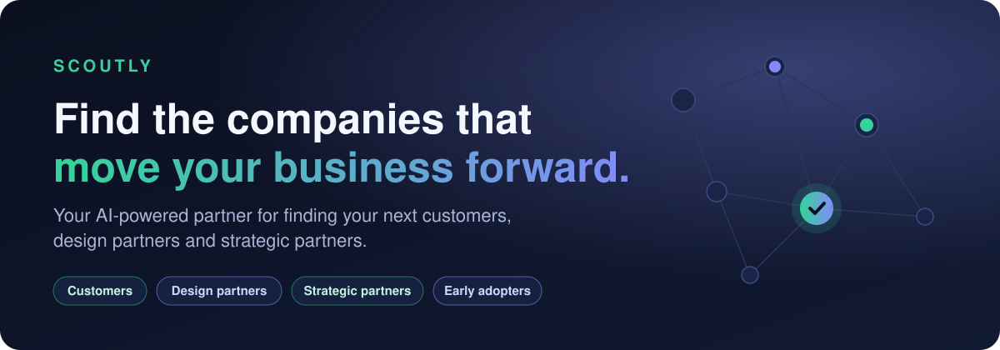
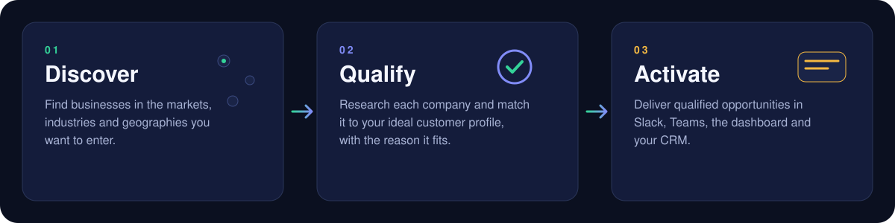
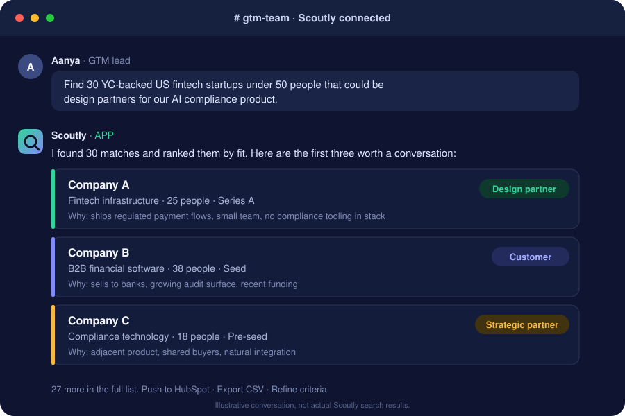
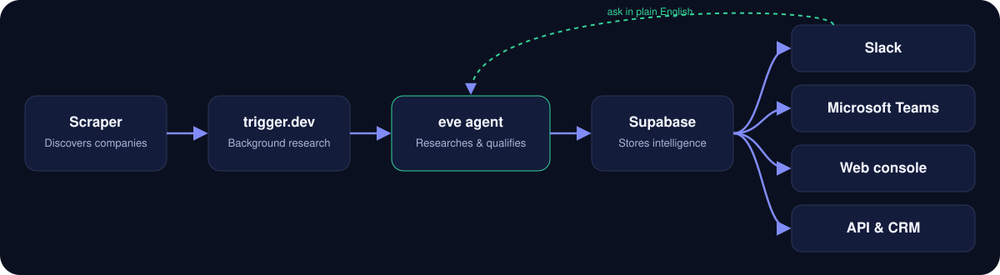

<div align="center">



<br>

**Stop spending hours searching for companies. Start having conversations with the right ones.**

[Why Scoutly](#the-problem) · [What you can find](#what-scoutly-finds-for-you) · [Ask it in Slack](#scoutly-lives-where-your-team-works) · [How it works](#how-it-works) · [Get started](#get-started)

</div>

---

## Your next customer is already out there

Scoutly is an AI-powered B2B prospecting and market-entry intelligence platform. Tell it which market you want to enter and what your ideal customer looks like. Its agent researches the companies, checks each one against your criteria, and hands your GTM team a curated shortlist of businesses worth talking to.

It is built for small and growing companies that need to answer three questions:

1. **Who should we sell to?**
2. **Who should we partner with?**
3. **Who should we approach to build and validate our product?**

> **The promise is not more leads. It's fewer irrelevant leads and more relevant business conversations.**

## The problem

Say you're a small SaaS startup building an AI product for financial services, and you want into the US market. You need customers with the problem you solve, design partners to shape the product, pilots willing to test it, and partners who can open doors.

Today your GTM team gets there by hand: LinkedIn, Google, startup directories, funding announcements, company websites. After hours of research they still can't say:

| | |
| --- | --- |
| Which companies are actually relevant? | Which fit our ideal customer profile? |
| Which have the budget or the need? | Which should we approach first? |
| **Why contact this company before that one?** | |

A database to browse doesn't fix that. A researched shortlist, with the reasoning attached, does.

## What Scoutly finds for you

| | You get | Scoutly looks for |
| --- | --- | --- |
| **Design partners** | Startups and businesses willing to shape your product | Teams with the problem you solve, the appetite to test early versions and give feedback |
| **Potential customers** | Companies that match your ICP | Industry, geography, size, business model and the signals that say they need you |
| **Strategic partners** | Complementary businesses | Integration and distribution opportunities, shared buyers, adjacent products |
| **Early adopters and pilots** | Companies that experiment | Teams likely to try emerging technology before everyone else |
| **Market-entry opportunities** | A map of a new market | Relevant businesses in a target geography or industry, before you spend GTM budget |

## Three pillars



| Pillar | What happens |
| --- | --- |
| **Discover** | Scoutly scans the market, industry and geography you care about and surfaces candidates |
| **Qualify** | The agent researches each company on the open web, works out what it actually does and who it sells to, and matches it against your ICP |
| **Activate** | Qualified opportunities arrive where your team already works: Slack, Teams, the dashboard and, soon, your CRM |

## Scoutly lives where your team works

Your sales team shouldn't open one more dashboard, apply filters and wade through hundreds of rows. They should talk to Scoutly the way they talk to a colleague.

<div align="center">

</div>

Every match comes with **why it fits**, so the person reaching out knows what to say and why this company comes before the next one.

| Where | How your team uses it |
| --- | --- |
| **Slack** | Ask in a channel or a DM, get qualified company lists back |
| **Microsoft Teams** | Bring discovery into your existing sales and BD workflow |
| **Discord** | For startup communities and founder-led teams |
| **Web workspace** | A dedicated place to browse, filter and chart your market |
| **API** | Let internal tools and other apps use Scoutly's intelligence |
| **CRM** | Push qualified prospects straight into HubSpot, Salesforce and others |

## Ask it like you'd ask a teammate

| If you are a... | You ask Scoutly |
| --- | --- |
| **AI SaaS startup** | "Find 50 companies that could become our first design partners." |
| **Cybersecurity startup** | "Which YC-backed companies with engineering teams could need our security product?" |
| **Fintech company** | "Identify US fintech startups that could become integration partners." |
| **Indian SaaS startup** | "Find US-based startups that match our ICP for market entry." |
| **Developer tools startup** | "Find early-stage companies building on our target technology stack." |
| **B2B sales team** | "Which companies just raised funding and fit our target customer profile?" |

Your team describes the market it wants to enter. Scoutly finds the companies worth talking to.

## Why start with YC-backed companies?

Y Combinator's portfolio is a concentrated ecosystem of startups across industries, stages and business models. For a company entering the startup world, that one pool holds potential B2B customers, early technology adopters, design partners, integration partners and strategic collaborators.

Take an Indian startup building an API security product that wants to expand into the US. It asks Scoutly for YC-backed companies that build developer infrastructure, have engineering teams, operate in the US, have fewer than 100 people and could benefit from API security. Scoutly researches them and returns a qualified shortlist.

**YC is the starting market, not the limit.** Scoutly is designed to expand into other startup ecosystems, private companies and broader business databases.

## How it works



1. **Describe your market.** Industry, geography, team size, revenue range, funding stage, B2B or B2C, the technology you care about.
2. **Scoutly researches.** An [eve](https://eve.dev) agent investigates every candidate on the web: what it builds, who it sells to, how it's funded, how big it is.
3. **Companies are qualified.** Each one is checked against your criteria. Those that don't fit are dropped, not stored with a flag, so the database holds clean, researched rows and nothing else.
4. **You get a shortlist.** Ranked, with the reason each company matches, in the tool your team already uses.

### Qualification you control

Scoutly ships with a default ICP, and every part of it is meant to be yours to change.

| Criterion | Default today | Yours to configure |
| --- | --- | --- |
| Geography | United States and Europe | Any target region |
| Team size | 500 people or fewer | Any range |
| Founded | 2015 or later | Any window |
| Revenue | Under $200M a year | Any range |
| Business model | B2B and B2C tagged | Filter by either |
| Fit | | Industries, funding stage, tech relevance, buying signals, design-partner and partnership suitability |

When a company doesn't publish its revenue, the agent estimates it and marks the row as an estimate. A reported number can always be told apart from an inferred one.

### Safe by design

Asking the agent a question in plain English turns it into SQL, and two independent barriers sit between that question and your data. A validator rejects anything that isn't a single read-only `SELECT` on the companies table, and the executor runs inside a read-only transaction, so the database itself refuses a write even if one slipped through.

## An honest note on what Scoutly claims

Scoutly **identifies and qualifies potential opportunities**. It does not claim that a company is ready to buy or willing to be a design partner. That only becomes true through real conversations, and Scoutly's job is to get you to the right ones faster.

## Get started

```bash
pnpm install
cd web && pnpm install && cd ..
pip install -r scraper/requirements.txt

cp .env.example .env
cp web/.env.example web/.env.local

pnpm scrape     # pull candidate companies
pnpm dev        # chat with the agent in your terminal
pnpm web        # open the workspace at http://localhost:3000
```

You'll need a Supabase project, an OpenRouter key for the agent's model and a Parallel API key for web research. Full setup, environment variables and deployment are in the [engineering guide](docs/ENGINEERING.md).

## Under the hood

| Component | Role |
| --- | --- |
| Python scraper | Discovers companies in the target market |
| eve agent | Researches and understands each company |
| Qualification engine | Matches companies to an ICP |
| Supabase Postgres | Stores researched company intelligence |
| trigger.dev | Runs background research at scale |
| Next.js console | The intelligence workspace |
| Conversational query tools | Let GTM teams ask in natural language |

## Learn more

| Document | Covers |
| --- | --- |
| [`docs/ENGINEERING.md`](docs/ENGINEERING.md) | Full technical guide: scraper, agent, pipeline, schema, console, deployment |
| [`docs/SPEC.md`](docs/SPEC.md) | Project specification |
| [`docs/what-how-trigger-is-working.md`](docs/what-how-trigger-is-working.md) | What runs on trigger.dev |
| [`docs/how-to-make-production-eve.md`](docs/how-to-make-production-eve.md) | Taking an eve agent to production |

<div align="center">

<br>

**Scoutly: discover markets, find opportunities, build relationships.**

</div>
